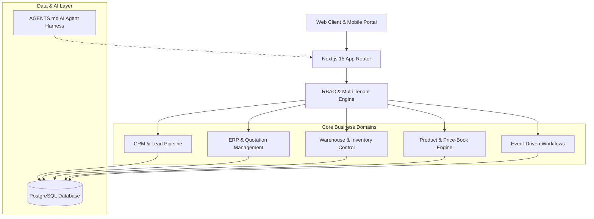

<p align="center">
  
</p>

<h1 align="center">PolarisERP</h1>
<h3 align="center">The North Star of Autonomous Enterprise Operations</h3>

<p align="center">
  <strong>AI-Native Enterprise CRM, ERP, Commerce & Warehouse Framework</strong><br />
  Architected for Autonomous AI Coding Agents & Multi-Tenant Business Back Offices
</p>

<p align="center">
  <a href="https://github.com/wtfear"></a>
  <a href="https://github.com/wtfear/PolarisERP/actions"></a>
  <a href="./LICENSE"></a>
  <a href="https://nextjs.org"></a>
  <a href="https://www.postgresql.org"></a>
</p>

---

## 🌟 Executive Overview

**PolarisERP** is an MIT-licensed, AI-native TypeScript enterprise framework built on **Next.js 15, PostgreSQL, and TurboRepo**. It ships with production-grade domain modules for customer relationships (**CRM**), enterprise resource planning (**ERP**), multi-channel commerce, inventory management (**WMS**), and automated workflows.

Instead of starting from a bare boilerplate or wrestling with rigid proprietary ERPs, PolarisERP begins **80% complete** — giving mid-market companies, SaaS platforms, and digital agencies an extensible, self-hosted operations backbone with **zero per-seat licensing fees**.

---

## 🏛️ Architecture & Capabilities



### 1. 💼 Integrated CRM & Pipeline Intelligence
- **Full Lifecycle Management:** Leads, contacts, accounts, deals, and activities.
- **Kanban & List Views:** Interactive deal stages, automated transition rules, and sales motions.
- **AI Lead Extraction:** Structured parsing of inbound RFPs, email threads, and invoices.

### 2. 📦 Turnkey ERP & Warehouse Management (WMS)
- **Quotation & Sales Orders:** Automated PDF generation, multi-currency pricing, and tax calculation.
- **Inventory & Stock Tracking:** Multi-warehouse bin tracking, replenishment thresholds, and batch tracking.
- **Supplier & Purchase Orders:** Procurement workflows, vendor catalogs, and receipt reconciliation.

### 3. 🤖 AI-Agentic Native Architecture (`AGENTS.md`)
- Built specifically for autonomous AI coding agents (**Claude Code, Cursor, Codex, Antigravity**).
- Architecture specs and strict domain module boundaries allow agents to generate features, migrations, and UI components without breaking conventions.

### 4. 🔒 Multi-Tenant & Granular RBAC
- Enterprise organization switching with strict data boundary isolation.
- Role-based permissions down to specific entity actions (View, Create, Edit, Delete, Export).

---

## 🚀 Quick Start (Local Docker)

The fastest way to experience PolarisERP is via the bundled Docker Compose environment:

```bash
# 1. Clone repository
git clone https://github.com/wtfear/PolarisERP.git
cd PolarisERP

# 2. Launch full application stack with PostgreSQL
docker compose -f docker-compose.yml up -d

# 3. Access local operations cockpit
open http://localhost:3000
```

Default credentials:
- **Cockpit URL:** `http://localhost:3000/start`
- **Admin Login:** `admin@wtfear.agency`
- **Initial Password:** `admin12345`

---

## ☁️ Cloud Deployment Matrix

PolarisERP is designed for cloud-native container deployments:

| Platform | Deployment Mode | Tier | Link |
|---|---|---|:---:|
| **Render** | Docker Web Service + PostgreSQL | Free / Starter | [Deploy to Render](https://render.com) |
| **Railway** | Dockerfile Auto-Deploy | Hobby / Pro | [Deploy to Railway](https://railway.app) |
| **Fly.io** | `fly launch` (Multi-region) | Pay-as-you-go | [Deploy to Fly.io](https://fly.io) |
| **Self-Hosted VPS** | Docker Compose + Traefik/Caddy | $5–$10/mo VPS | Direct SSH |

---

## 🌌 The WTFear Star Portfolio

PolarisERP is the flagship enterprise operations backbone in the **WTFear Celestial AI Suite**:

| Star | Flagship Platform | Category | Stack |
|---|---|---|---|
| **Polaris** | **`PolarisERP`** | AI-Native Enterprise CRM & ERP Framework | Next.js 15, PostgreSQL, TypeScript |
| **Sirius** | **`SiriusIQ`** | Enterprise Autonomous RAG & Knowledge Hub | FastAPI, Vespa/Qdrant, Next.js |
| **Vega** | **`VegaVoice`** | Sub-500ms Real-Time Conversational Voice Agent | LiveKit 1.8, Deepgram, Groq Llama-3.3 |
| **Rigel** | **`RigelPersona`** | Autonomous AI Persona & Mentorship Simulator | Next.js 15, Gemini API, Tailwind |
| **Antares** | **`AntaresAudit`** | AI SEO, Performance & Website Auditor | React 19, Express, PDFKit, Groq |
| **Capella** | **`CapellaBI`** | Executive Financial BI-as-Code Cockpit | Evidence Core, DuckDB-WASM, Markdown |

---

## 📄 License & Attribution

- **Core License:** [MIT License](./LICENSE) — 100% Free for commercial, agency, and client white-label deployments.
- **Created & Maintained by:** [WTFear Agency](https://github.com/wtfear) & **Pavan Kumar Kunukuntla**.
